# Awesome Content Creation & AI Writing Assistant [](https://github.com/ishandutta2007/Awesome-Awesome-Awesome)

<p align="center">
  
</p>

<p align="center">
  <a href="https://github.com/ishandutta2007/Awesome-Awesome-Awesome"></a>
  <a href="https://discord.gg/jc4xtF58Ve"></a>
  <a href="https://github.com/ishandutta2007/Awesome-Content-Creation-AI-Writing-Assistant/stargazers"></a>
  <a href="https://github.com/ishandutta2007/Awesome-Content-Creation-AI-Writing-Assistant/network/members"></a>
  <a href="https://github.com/ishandutta2007/Awesome-Content-Creation-AI-Writing-Assistant/issues"></a>
  <a href="https://github.com/ishandutta2007/Awesome-Content-Creation-AI-Writing-Assistant/blob/main/LICENSE"></a>
  <a href="https://github.com/ishandutta2007"></a>
</p>

<p align="center">
  <strong>Curated directory of top-tier SaaS platforms, autonomous deep research agents, local LLM writing runtimes, self-hosted studios, and prose/grammar linters.</strong>
</p>

---

## 🧭 Navigation & Table of Contents

- [🌟 Overview & SEO Keywords](#-overview--seo-keywords)
- [📊 Sector Overview & Market Dynamics](#-sector-overview--market-dynamics)
- [💼 Top SaaS & Hosted AI Writing Platforms](#-top-saas--hosted-ai-writing-platforms)
- [💻 Open-Source GitHub Projects](#-open-source-github-projects)
  - [🏆 High-Star Flagships & Autonomous Research](#-high-star-flagships--autonomous-research)
  - [📝 Markdown Studios, CMS & Knowledge Editors](#-markdown-studios-cms--knowledge-editors)
  - [⚡ Grammar Checkers & Style Linters](#-grammar-checkers--style-linters)
  - [🎭 Creative Fiction & Narrative Writing Studios](#-creative-fiction--narrative-writing-studios)
- [🛠️ Recommended Architecture & Workflows](#️-recommended-architecture--workflows)
- [🤝 How to Contribute](#-how-to-contribute)
- [💖 Support & Sponsorship](#-support--sponsorship)
- [📈 Star History](#-star-history)
- [⚖️ Disclaimer](#️-disclaimer)

---

## 🌟 Overview & SEO Keywords

Welcome to the definitive **Awesome Content Creation & AI Writing Assistant** repository — tracking the state of the art in generative artificial intelligence for content marketers, copywriters, technical writers, novelists, researchers, and developers.

Whether you need automated SEO/GEO (Generative Engine Optimization) article generation, real-time AI copywriting scoring, local offline LLM drafting, autonomous web research agents, or continuous style guide enforcement in CI/CD pipelines, this curated index covers both production enterprise SaaS suites and developer-friendly open-source frameworks.

> **Target Capabilities:** `AI Copywriting` • `SEO Content Briefs` • `Generative Engine Optimization (GEO)` • `Autonomous Deep Research Agents` • `Self-Hosted Markdown Editors` • `Prose Linters` • `Grammar Checkers` • `Local LLMs (Ollama / LocalAI)` • `Distraction-Free Publishing CMS`

---

## 📊 Sector Overview & Market Dynamics

The global AI writing assistant and generative content creation market is estimated at approximately **$2.5B–$3.5B** in 2024–2026, compounding at a **22%–25% CAGR** toward **$20B+** over the next decade. 

### Market Concentration vs. Fragmentation
* **Foundational Platform Concentration (High):** At the infrastructure and OS integration level, market share is heavily concentrated in the hands of foundation model creators and major tech platforms (OpenAI, Microsoft Copilot, Google Gemini Workspace) that embed generative writing into omnipresent document suites.
* **Application & Vertical SaaS Fragmentation (Moderate to High):** At the application layer, the market is fragmented. No single player holds a monopoly because distinct user cohorts require bespoke workflows:
  * **E-Commerce & Catalog Teams** lean into high-throughput bulk SKU generation (Hypotenuse AI).
  * **Growth & Performance Marketers** demand predictive conversion analytics and brand compliance (Anyword, Copy.ai).
  * **Search & SEO Strategists** prioritize SERP research, content clustering, and GEO tracking (Writesonic, Scalenut, Frase).
  * **Privacy-Conscious Teams & Authors** migrate toward local offline LLM runtimes, self-hosted editors, and open-source prose linters (Ollama, Open WebUI, AppFlowy, Harper, Vale).

---

## 💼 Top SaaS & Hosted AI Writing Platforms

Below is a curated comparison of leading SaaS products, ordered by estimated business scale and revenue/valuation (descending).

| Platform | Core Capabilities & Description | Starting Pricing (Specific Tier) | Free Tier / Free Trial Limits | Company Scale (Est. Revenue / Valuation) |
| :--- | :--- | :--- | :--- | :--- |
| **[Jasper](https://jasper.ai)** | Enterprise AI marketing and content creation platform featuring brand-voice enforcement, multi-channel campaign workflows, and collaborative document editing. | **$49/mo** (billed annually) or **$69/mo** (monthly) for *Pro* tier (1 seat) | **7-day free trial** (credit card required; full access to Pro features, brand voices, and AI agents) | ~$1.5B Valuation / ~$85M–$95M ARR |
| **[Copy.ai](https://copy.ai)** | AI-powered GTM and content workflow automation platform turning briefs, transcripts, and customer research into structured blog posts, ad copy, and outreach sequences. | **$24/mo** (billed annually) or **$29/mo** (monthly) for *Chat* tier (5 seats) | **No permanent free plan**; provides one-time **200 free trial workflow credits** upon signup | ~$25M–$35M ARR / ~$14M total VC funding raised |
| **[Anyword](https://anyword.com)** | Data-driven AI copywriting platform featuring predictive performance scoring for ad copy, landing pages, email subject lines, and social campaigns. | **$39/mo** (billed annually) or **$49/mo** (monthly) for *Starter* tier (1 seat) | **7-day free trial** (includes unlimited copy generation, 1 brand voice, and 50 predictive performance scores) | ~$84M Valuation / ~$15M–$20M ARR |
| **[Pepper Content (Peppertype)](https://peppercontent.io)** | Content marketing and operations platform pairing AI copywriting assistants (*Pepper Docs*) with editorial workflows, SEO audits, and freelance management. | **$35/mo** (billed annually) or **$49/mo** (monthly) for *AI Starter* tier | **7-day free trial** (grants trial access to Pepper Docs AI editor, SEO briefs, and core copywriting templates) | ~$57M Valuation / ~$11M–$16M ARR |
| **[Scalenut](https://scalenut.com)** | End-to-end AI-powered SEO and content marketing platform offering keyword clustering, Cruise Mode long-form article drafting, and real-time NLP optimization. | **$21/mo** (promotional annual billing) or **$59/mo** (monthly) for *Starter* tier | **7-day free trial** (includes Cruise Mode long-form article generation, SEO editor, and keyword research) | ~$10M ARR / ~$3.5M total VC funding raised |
| **[Writesonic](https://writesonic.com)** | AI writing, SEO article generation, and GEO (Generative Engine Optimization) platform combining real-time web research, competitor analysis, and brand-tone customization. | **$79/mo** (billed annually) or **$99/mo** (monthly) for *Starter* tier (1 seat) | **7-day free trial** (no credit card required; limited AI article generation and site audit trials) | ~$8M–$10M ARR / ~$250M estimated market valuation |
| **[Rytr](https://rytr.me)** | Lightweight, fast AI writing assistant offering 40+ copywriting templates, tone controls, plagiarism checks, and inline text expansion/rewriting. | **$7.50/mo** (billed annually) or **$9/mo** (monthly) for *Saver/Unlimited* tier | **Free Forever plan**: capped at **10,000 characters per month** (~1,500–1,800 words), 40+ templates, 30+ languages, 20+ tones | Acquired by Copysmith / ~$2M–$5M ARR run-rate |
| **[Hypotenuse AI](https://hypotenuse.ai)** | AI content creation suite specialized in bulk e-commerce product descriptions, factual long-form articles, and brand-consistent marketing assets. | **$24/mo** (billed annually) or **$29/mo** (monthly) for *Individual* tier | **7-day free trial** (access to bulk product description generator, blog article drafts, image generation) | ~$3M ARR / Y Combinator backed (Seed) |
| **[Frase](https://frase.io)** | SEO content research and AI writing assistant that analyzes top search results to generate structured content briefs, outlines, and topic-scored drafts. | **$39/mo** (billed annually) or **$49/mo** (monthly) for *Starter* tier (1 seat) | **7-day free trial** (no credit card required; 1 domain, full SEO brief & outline builder access) | Acquired by Copysmith / ~$1.8M ARR |
| **[ContentBot](https://contentbot.ai)** | Automated AI content workflow and long-form blog writer supporting drag-and-drop content flows, paraphrasing, and scheduled content generation. | **$9/mo** for *Starter* tier (or **$0.50/1k words** prepaid) | **No recurring free plan**; allocates **10,000 free words** introductory credit bonus on first purchase/signup | Bootstrapped / Micro-SaaS (<$1M ARR) |

---

## 💻 Open-Source GitHub Projects

All open-source repositories below are verified active projects, sorted in **descending order by GitHub Stars_Count**. Each entry features an official social Stars_Badge directly linking to that repository's stargazers page.

### 🏆 High-Star Flagships & Autonomous Research

1. **[ollama/ollama](https://github.com/ollama/ollama)** [](https://github.com/ollama/ollama/stargazers)  
   The industry-standard runtime to get up and running with local writing models (Llama 3, Qwen 2.5, Mistral, Gemma, DeepSeek) via an OpenAI-compatible API on macOS, Linux, and Windows.

2. **[open-webui/open-webui](https://github.com/open-webui/open-webui)** [](https://github.com/open-webui/open-webui/stargazers)  
   Feature-rich self-hosted AI interface and writing workspace offering prompt pipelines, RAG document libraries, voice dictation, and multi-model drafting for local Ollama instances.

3. **[AppFlowy-IO/AppFlowy](https://github.com/AppFlowy-IO/AppFlowy)** [](https://github.com/AppFlowy-IO/AppFlowy/stargazers)  
   The leading open-source Notion alternative built in Flutter and Rust. Brings projects, wikis, and document writing together with privacy-first AI generation and local model support.

4. **[toeverything/AFFiNE](https://github.com/toeverything/AFFiNE)** [](https://github.com/toeverything/AFFiNE/stargazers)  
   Next-generation open-source workspace and canvas-to-document writing studio. Features local-first data architecture, multi-modal editing, and integrated AI drafting blocks.

5. **[typst/typst](https://github.com/typst/typst)** [](https://github.com/typst/typst/stargazers)  
   A modern, markup-based typesetting system that is powerful and easy to learn. Delivers instant live compilation for technical reports, research papers, and books.

6. **[laurent22/joplin](https://github.com/laurent22/joplin)** [](https://github.com/laurent22/joplin/stargazers)  
   Privacy-focused, open-source note-taking and long-form Markdown writing studio with end-to-end encryption (E2EE) and extensive AI plugin integrations.

7. **[TryGhost/Ghost](https://github.com/TryGhost/Ghost)** [](https://github.com/TryGhost/Ghost/stargazers)  
   The premier open-source publishing CMS and newsletter platform for independent content creators, journalists, and modern editorial teams.

8. **[mudler/LocalAI](https://github.com/mudler/LocalAI)** [](https://github.com/mudler/LocalAI/stargazers)  
   Drop-in OpenAI-compatible REST API replacement for local CPU/GPU inferencing. Powers self-hosted AI writing bots, summarization endpoints, and embeddings.

9. **[logseq/logseq](https://github.com/logseq/logseq)** [](https://github.com/logseq/logseq/stargazers)  
   Privacy-first, local-first outliner and interconnected knowledge base for connected note-taking, technical outlining, and AI-assisted thought structuring.

10. **[outline/outline](https://github.com/outline/outline)** [](https://github.com/outline/outline/stargazers)  
    Fast, beautiful, collaborative open-source team knowledge base and Markdown document editor with real-time multiplayer editing and API automation.

11. **[khoj-ai/khoj](https://github.com/khoj-ai/khoj)** [](https://github.com/khoj-ai/khoj/stargazers)  
    Your open-source AI second brain. Deep-researches queries across personal notes, PDF files, and the web, outputting structured reports and cited drafts using local or cloud LLMs.

12. **[onyx-dot-app/onyx](https://github.com/onyx-dot-app/onyx)** (formerly Danswer) [](https://github.com/onyx-dot-app/onyx/stargazers)  
    Open-source enterprise AI search and content drafting platform. Connects to internal wikis, Google Docs, and Jira to generate factual, cited enterprise communications.

13. **[stanford-oval/storm](https://github.com/stanford-oval/storm)** [](https://github.com/stanford-oval/storm/stargazers)  
    Stanford's open-source LLM research engine that explores topics from diverse perspectives, surfaces citations, and synthesizes full-length Wikipedia-style reference articles.

14. **[assafelovic/gpt-researcher](https://github.com/assafelovic/gpt-researcher)** [](https://github.com/assafelovic/gpt-researcher/stargazers)  
    Autonomous deep-research agent that searches 20+ web sources concurrently to assemble unbiased, comprehensive, citation-rich research dossiers and articles.

---

### 📝 Markdown Studios, CMS & Knowledge Editors

15. **[steven-tey/novel](https://github.com/steven-tey/novel)** [](https://github.com/steven-tey/novel/stargazers)  
    Notion-style WYSIWYG React editor equipped with AI-powered autocompletion slash commands, built with Tiptap and the Vercel AI SDK.

16. **[Zettlr/Zettlr](https://github.com/Zettlr/Zettlr)** [](https://github.com/Zettlr/Zettlr/stargazers)  
    Academic and professional Markdown authoring workbench supporting Zettelkasten knowledge management, citeproc reference integration, and distraction-free writing.

17. **[quarto-dev/quarto-cli](https://github.com/quarto-dev/quarto-cli)** [](https://github.com/quarto-dev/quarto-cli/stargazers)  
    Open-source scientific and technical publishing system built on Pandoc. Interweaves executable code (Python, R, Julia) and text into high-impact publications.

18. **[KDE/ghostwriter](https://github.com/KDE/ghostwriter)** [](https://github.com/KDE/ghostwriter/stargazers)  
    Distraction-free Markdown text editor by KDE featuring Hemingway mode (disabling backspace), live HTML preview, and document statistics.

---

### ⚡ Grammar Checkers & Style Linters

19. **[Automattic/harper](https://github.com/Automattic/harper)** [](https://github.com/Automattic/harper/stargazers)  
    High-speed, offline-first grammar and style checker written in Rust by Automattic. Analyzes text locally inside editors and browsers in milliseconds with zero telemetry.

20. **[languagetool-org/languagetool](https://github.com/languagetool-org/languagetool)** [](https://github.com/languagetool-org/languagetool/stargazers)  
    The premier multilingual grammar, style, and spell checking engine supporting 30+ languages. Easily self-hostable via Docker with rich API and plugin ecosystems.

21. **[errata-ai/vale](https://github.com/errata-ai/vale)** [](https://github.com/errata-ai/vale/stargazers)  
    Syntax-aware open-source prose linter written in Go. Enforces custom corporate style guides (Google, Microsoft, Proselint) directly across Markdown, AsciiDoc, and HTML in CI/CD.

---

### 🎭 Creative Fiction & Narrative Writing Studios

22. **[SillyTavern/SillyTavern](https://github.com/SillyTavern/SillyTavern)** [](https://github.com/SillyTavern/SillyTavern/stargazers)  
    Advanced local LLM frontend and narrative studio for power users. Offers lorebook/world-info context injection, character cards, and branching story generation.

23. **[LostRuins/koboldcpp](https://github.com/LostRuins/koboldcpp)** [](https://github.com/LostRuins/koboldcpp/stargazers)  
    Zero-install single-file executable for running GGUF models locally with a dedicated KoboldAI narrative interface, adventure modes, and memory scratchpads.

24. **[bitti-ai/slopus](https://github.com/bitti-ai/slopus)** [](https://github.com/bitti-ai/slopus/stargazers)  
    Local-first AI media harness tailored for autonomous planning, multi-step text generation, and iterative content editing.

---

## 🛠️ Recommended Architecture & Workflows

Build custom, resilient production writing pipelines using open components:

```
┌────────────────────────────────────────────────────────┐
│            1. RESEARCH & KNOWLEDGE GATHERING            │
│       GPT Researcher / Stanford STORM / Khoj / Onyx    │
└───────────────────────────┬────────────────────────────┘
                            │ (Structured Markdown Briefs & Citations)
                            ▼
┌────────────────────────────────────────────────────────┐
│             2. LOCAL LLM DRAFTING & OUTLINING          │
│       Ollama / LocalAI + Open WebUI / Novel / Slopus   │
└───────────────────────────┬────────────────────────────┘
                            │ (Initial Long-Form Draft)
                            ▼
┌────────────────────────────────────────────────────────┐
│         3. AUTOMATED EDITING & STYLE LINTING           │
│       Harper (Grammar) + Vale (Brand Style in CI/CD)   │
└───────────────────────────┬────────────────────────────┘
                            │ (Polished, Brand-Compliant Article)
                            ▼
┌────────────────────────────────────────────────────────┐
│           4. MULTI-CHANNEL COLLAB & PUBLISHING         │
│          AppFlowy / Outline / Ghost CMS / Typst        │
└────────────────────────────────────────────────────────┘
```

---

## 🤝 How to Contribute

Contributions are warmly welcomed! Help keep this directory current, accurate, and useful for the global writer and developer community.

1. **Fork the repository** to your GitHub account.
2. **Add or update entries** in `README.md`:
   - Keep descriptions concise, factual, and neutral (1–2 sentences).
   - Ensure open-source projects include official links and stay ordered by stars.
   - For SaaS tools, include verified starting tier prices and exact free tier/trial limits.
3. **Submit a Pull Request** with a brief summary of what was added or updated.

---

## 💖 Support & Sponsorship

If you find this curated directory helpful for your projects, writing workflows, or research, consider supporting the work:

- ⭐ **Star this repository** to help others discover it across GitHub.
- 🍴 **Fork & Share** it with your team, fellow writers, and developer communities on X/Twitter, LinkedIn, and Reddit.
- ☕ **Buy me a coffee & Sponsor:** If you or your organization would like to support continuous maintenance, feature additions, or sponsor a project badge/listing, please visit the [**GitHub Sponsors Dashboard**](https://github.com/sponsors/ishandutta2007). Every bit of support makes a tremendous difference!

<p align="center">
  <a href="https://github.com/sponsors/ishandutta2007">
    
  </a>
</p>

---

## 📈 Star History

[](https://www.star-history.com/#ishandutta2007/Awesome-Content-Creation-AI-Writing-Assistant&type=date&legend=top-left)

---

## ⚖️ Disclaimer

- This is an independent, community-curated list — neither endorsed by nor affiliated with any featured third-party service.
- Generative AI writing tools can produce factual hallucinations, outdated assertions, or unintended similarities; always verify citations and conduct thorough human editorial review prior to commercial publication.
- Abide by search-engine guidelines and applicable jurisdiction disclosure laws regarding AI-assisted content distribution.

---

<p align="center">
  <sub>Crafted with care for copywriters, technical authors, SEO strategists, novelists, and open-source developers worldwide.</sub>
</p>
